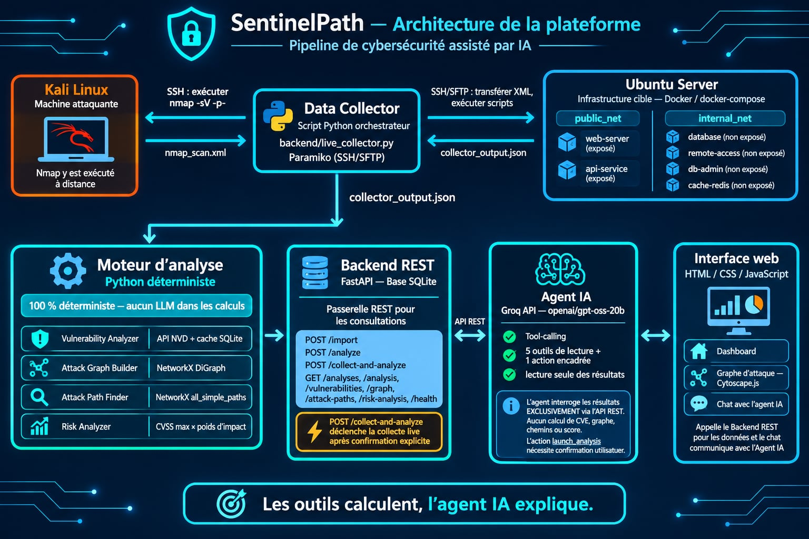

# SentinelPath

**AI Agent for Vulnerability & Attack Path Analysis**


[](https://github.com/emirghdiri/ai-cybersecurity-agent/actions/workflows/tests.yml)


---

## Overview

Sur une infrastructure réelle, corréler manuellement les vulnérabilités connues avec la topologie réseau est lent, et il est difficile de savoir quelle faille corriger en premier. Une CVE critique sur un service isolé pèse moins qu'une faille moyenne qui ouvre la route vers la base de données.

**SentinelPath** est un agent IA orchestrateur qui automatise cette chaîne : il collecte l'infrastructure, détecte les CVE de chaque service via la base NVD, construit un graphe d'attaque, en déduit les chemins possibles vers les ressources critiques, priorise le risque et explique le tout en langage naturel.

Principe directeur : **les outils calculent, l'agent IA explique.** Aucune CVE ni aucun chemin d'attaque n'est deviné par le LLM ; tout provient de modules Python déterministes et vérifiables, que l'agent appelle comme des outils.

---

## Architecture



La plateforme est organisée en six blocs :

1. **Laboratoire** : une machine attaquante **Kali Linux** et une machine cible **Ubuntu Server**, dont les services tournent en conteneurs Docker répartis entre un réseau public (`public_net`, exposé) et un réseau interne isolé (`internal_net`).
2. **Data Collector** (`backend/live_collector.py`, paramiko) : l'orchestrateur Python de la collecte. Par SSH, il lance `nmap -sV -p-` sur Kali (vue externe, celle d'un attaquant) et récupère `nmap_scan.xml` ; puis il exécute l'inventaire local sur Ubuntu (conteneurs, réseaux Docker) et récupère le résultat par SFTP. Les deux vues sont fusionnées en `collector_output.json`.
3. **Moteur d'analyse, 100 % déterministe** (aucun LLM dans les calculs) : Vulnerability Analyzer (API NVD + cache SQLite, CISA KEV), Attack Graph Builder (NetworkX DiGraph), Attack Path Finder (NetworkX `all_simple_paths`) et Risk Analyzer (CVSS max × poids d'impact).
4. **Backend REST** (FastAPI + SQLite) : la passerelle unique vers les résultats et l'historique des analyses (`/import`, `/analyze`, `/collect-and-analyze`, `/analyses`, `/vulnerabilities`, `/graph`, `/attack-paths`, `/risk-analysis`, `/health`).
5. **Agent IA** (Groq, `openai/gpt-oss-20b`) : par tool calling, il interroge les résultats **exclusivement via l'API REST** (outils de lecture seule) et dispose d'une seule action, `launch_analysis`, qui déclenche une collecte live après confirmation explicite de l'utilisateur. Il ne calcule ni CVE, ni graphe, ni chemin, ni score.
6. **Interface web** (HTML / CSS / JavaScript) : tableau de bord, graphe d'attaque interactif (Cytoscape.js) et chat avec l'agent.

**Flux de données**

```
Kali (nmap) + Ubuntu (inventaire) ──SSH/SFTP──► Data Collector ──► collector_output.json
    ──► Moteur d'analyse ──► Backend REST (SQLite) ◄──► Agent IA
                                    ▲
                                    └──► Interface web
```

Chaque étape communique par un fichier JSON au format documenté : chaque module peut être testé et rejoué indépendamment.

---

## Key Features

- **Collecte live en un clic** : depuis l'interface (ou l'agent), SentinelPath lance par SSH un scan Nmap depuis la machine attaquante et un inventaire sur la machine cible (ports, services, conteneurs et réseaux Docker), puis fusionne les deux vues pour distinguer les services réellement exposés.
- **Actifs internes analysés** : les conteneurs sans port publié, invisibles pour un scan externe (base de données, cache…), sont identifiés à partir de leur image Docker. Une étiquette imprécise (`latest`) laisse la version « inconnue » plutôt que de la deviner.
- **Détection de vulnérabilités via NVD**, avec un cache SQLite local, et repérage des **CVE activement exploitées** (catalogue CISA KEV).
- **Graphe d'attaque réaliste** (NetworkX), y compris les pivots entre conteneurs via les réseaux Docker internes.
- **Chemins d'attaque** de la machine attaquante vers chaque ressource critique, avec un **score de risque** qui combine la pire CVSS du chemin, la nature de la cible (actif interne ou point d'entrée) et la présence de CVE exploitées.
- **Agent IA avec tool calling** (Groq, `openai/gpt-oss-20b`) : il choisit lui-même les outils à appeler (vulnérabilités, graphe, chemins, risque, historique), compare deux analyses et peut relancer une collecte à la demande. Il n'invente aucune donnée : les absences sont signalées explicitement (« non disponible », « vulnérabilités inconnues »).
- **Interface web** : tableau de bord, filtre des CVE exploitées, graphe interactif, chemins classés par risque, historique des analyses et chat avec l'agent.

---

## Tech Stack

| Domaine | Technologies |
|---|---|
| Langage | Python |
| API backend | FastAPI |
| Stockage | SQLite (historique des analyses, cache CVE) |
| Graphe d'attaque | NetworkX |
| Collecte | Nmap, psutil, Docker, SSH/SFTP (paramiko) |
| Base de vulnérabilités | NVD API 2.0, catalogue CISA KEV |
| Agent IA | Groq API, tool calling (`openai/gpt-oss-20b`) |
| Frontend | HTML / JavaScript |
| Visualisation du graphe | Cytoscape.js |
| Tests | pytest, GitHub Actions |

---

## Lab Environment

Le projet est développé et évalué sur un laboratoire isolé de deux machines virtuelles :

- **Machine attaquante** : Kali Linux, d'où sont lancés les scans externes.
- **Machine cible** : Ubuntu Server, qui héberge plusieurs services volontairement vulnérables dans des conteneurs Docker.

Les conteneurs sont répartis sur deux réseaux : un **réseau public**, exposé à la machine attaquante, et un **réseau interne isolé**, joignable uniquement par certains conteneurs servant de pivot. Cette séparation permet de vérifier que SentinelPath détecte non seulement les failles directement exposées, mais aussi les chemins d'attaque en plusieurs étapes.

---

## Project Structure

```
.
├── collector/       Inventaire local (psutil, Docker) et fusion avec le scan Nmap
├── vulnerability/   Recherche des CVE via l'API NVD (cache SQLite, statut CISA KEV)
├── agent/           Graphe d'attaque, chemins, score de risque, et agent IA (Groq)
├── backend/         API FastAPI : analyses, collecte live par SSH, chat avec l'agent
├── frontend/        Interface web : tableau de bord, graphe interactif, chat
├── tests/           Tests automatiques (pytest), exécutés par GitHub Actions
├── samples/         Exemples de fichiers d'entrée et de sortie (données fictives)
└── docs/            Documentation et schémas d'architecture
```

---

## Getting Started

**1. Cloner le dépôt et installer les dépendances**

```bash
git clone https://github.com/emirghdiri/ai-cybersecurity-agent.git
cd ai-cybersecurity-agent
python3 -m venv .venv && source .venv/bin/activate
pip install -r requirements.txt
```

**2. Configurer les clés** (variables d'environnement uniquement, jamais dans le code)

```bash
export GROQ_API_KEY="..."     # agent IA (chat)
export NVD_API_KEY="..."      # optionnel : accélère les requêtes NVD
```

**3. Configurer la collecte live** (accès SSH aux deux machines du labo)

```bash
export KALI_SSH_HOST="<ip-kali>"     KALI_SSH_USER="kali"  KALI_SSH_KEY="~/.ssh/id_ed25519"
export UBUNTU_SSH_HOST="<ip-ubuntu>" UBUNTU_SSH_USER="..." UBUNTU_SSH_KEY="~/.ssh/id_ed25519"
export NMAP_TARGET="<ip-de-la-cible-sur-le-reseau-du-labo>"
```

Sur Kali, autorisez uniquement la commande exacte du scan avec `sudo visudo -f /etc/sudoers.d/sentinelpath-nmap` :

```
kali ALL=(root) NOPASSWD: /usr/bin/nmap -sV -T4 -p- -oX /home/kali/sentinelpath_nmap.xml <ip-cible>
```

Une règle `nmap *` donnerait en pratique un accès root (`--script`) : tous les arguments sont donc figés.

**4. Lancer SentinelPath**

```bash
python -m uvicorn backend.main:app --reload
```

Ouvrez http://127.0.0.1:8000, puis cliquez sur **Lancer une analyse** (collecte live puis analyse). Sans collecte live configurée, importez un `collector_output.json` via `POST /import` (voir http://127.0.0.1:8000/docs).

**5. Lancer les tests**

```bash
pytest
```

Les tests n'utilisent ni le réseau ni les VMs. Les résultats de scan réels (`local_inventory.json`, `nmap_scan.xml`, `collector_output.json`, base `backend/data/`…) sont exclus du dépôt par le `.gitignore`.

---

## Limits

- Les CVE sont **déduites des versions** des logiciels (base NVD) : leur exploitabilité réelle sur la machine n'est pas testée.
- La version d'un conteneur interne vient de l'**étiquette de son image** Docker, pas d'une mesure directe.
- Le score de risque est volontairement simple et explicable (pire CVSS, nature de la cible, bonus CVE exploitée) : c'est une aide à la priorisation, pas une probabilité d'attaque.

---

## Authors

| | Rôle | GitHub |
|---|---|---|
| **Amir Ghdiri** | Collecte, infrastructure, agent IA | [@emirghdiri](https://github.com/emirghdiri) |
| **Arij Cheikhrouhou** | Analyse des vulnérabilités, backend | [@arijcheikhrouhou](https://github.com/arijcheikhrouhou) |

Les règles de travail en équipe sont décrites dans [CONTRIBUTING.md](CONTRIBUTING.md).

---

## License

Distribué sous licence MIT. Voir [LICENSE](LICENSE).

> Projet à visée pédagogique. Les outils de scan ne doivent être utilisés que sur des systèmes dont vous avez l'autorisation explicite.
