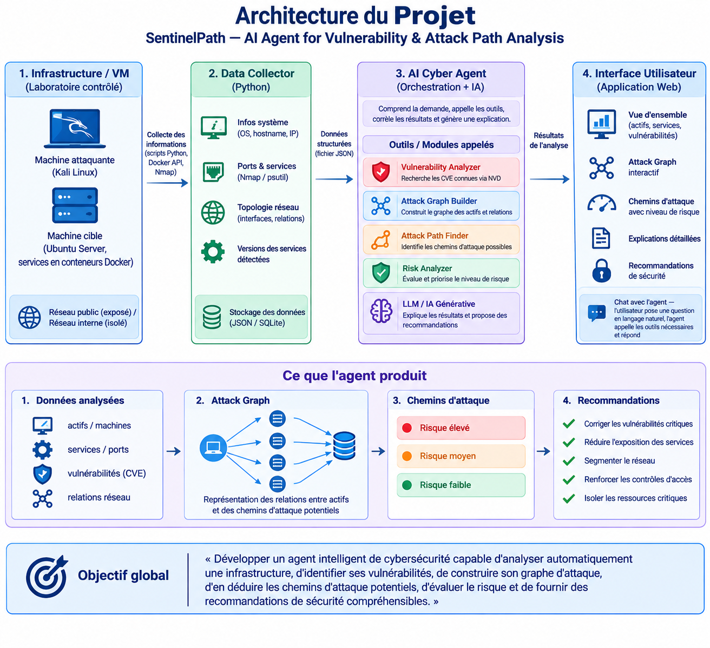

# SentinelPath

**AI Agent for Vulnerability & Attack Path Analysis**


---

## Overview

Sur une infrastructure réelle, corréler manuellement les vulnérabilités connues avec la topologie réseau est lent, et il est difficile de savoir quelle faille corriger en premier. Une CVE critique sur un service isolé pèse moins qu'une faille moyenne qui ouvre la route vers la base de données.

**SentinelPath** est un agent IA orchestrateur qui automatise cette chaîne : il collecte l'infrastructure, détecte les CVE de chaque service via la base NVD, construit un graphe d'attaque, en déduit les chemins possibles vers les ressources critiques, priorise le risque et explique le tout en langage naturel.

Principe directeur : **les outils calculent, l'agent IA explique.** Aucune CVE ni aucun chemin d'attaque n'est deviné par le LLM ; tout provient de modules Python déterministes et vérifiables, que l'agent appelle comme des outils.

---

## Architecture



Le système est organisé en quatre couches :

1. **Infrastructure / VM** : un laboratoire contrôlé composé d'une machine attaquante et d'une machine cible dont les services tournent en conteneurs Docker, répartis entre un réseau public exposé et un réseau interne isolé.
2. **Data Collector** : des scripts Python qui relèvent les informations système, les ports et services avec leurs versions (psutil, Docker, Nmap) et la topologie réseau, puis produisent un fichier JSON structuré.
3. **AI Cyber Agent** : l'orchestrateur, qui comprend la demande, appelle cinq modules spécialisés (Vulnerability Analyzer, Attack Graph Builder, Attack Path Finder, Risk Analyzer, LLM) et corrèle leurs résultats.
4. **Interface utilisateur** : une application web qui présente la vue d'ensemble, le graphe d'attaque interactif, les chemins classés par risque, les recommandations, et un chat avec l'agent.

**Flux de données**

```
Infrastructure ──► collector_output.json ──► modules d'analyse ──► analysis_result.json ──► Backend (FastAPI) ──► Frontend
```

Chaque étape communique par un fichier JSON au format documenté : chaque module peut être testé et rejoué indépendamment.

---

## Key Features

- **Collecte automatique de l'infrastructure** : OS, ports en écoute, versions des services, conteneurs et réseaux Docker, fusionnés avec un scan Nmap externe pour distinguer les services réellement exposés.
- **Détection de vulnérabilités via NVD**, avec un cache SQLite local pour limiter les appels à l'API et rejouer les analyses hors ligne.
- **Graphe d'attaque réaliste** (NetworkX) construit à partir des services exposés, des vulnérabilités et des relations réseau, y compris les pivots entre conteneurs.
- **Identification des chemins d'attaque** depuis la machine attaquante jusqu'à une ressource critique (par exemple la base de données).
- **Scoring et priorisation du risque** de chaque chemin, en combinant la sévérité CVSS, l'exposition et la criticité de la cible.
- **Agent IA avec tool calling** (LangGraph / LangChain) qui orchestre les modules et rédige des explications et des recommandations de remédiation.
- **Interface web avec chat interactif** pour explorer les résultats et interroger l'agent en langage naturel.

---

## Tech Stack

| Domaine | Technologies |
|---|---|
| Langage | Python |
| API backend | FastAPI |
| Stockage | SQLite (cache CVE), fichiers JSON |
| Graphe d'attaque | NetworkX |
| Laboratoire | Docker |
| Découverte réseau | Nmap, psutil |
| Base de vulnérabilités | NVD API 2.0 |
| Agent IA | LangGraph / LangChain |
| Frontend | React ou HTML/JS |
| Visualisation du graphe | Cytoscape.js ou D3.js |

---

## Lab Environment

Le projet est développé et évalué sur un laboratoire isolé de deux machines virtuelles :

- **Machine attaquante** : Kali Linux, d'où sont lancés les scans externes.
- **Machine cible** : Ubuntu Server, qui héberge plusieurs services volontairement vulnérables dans des conteneurs Docker.

Les conteneurs sont répartis sur deux réseaux : un **réseau public**, exposé à la machine attaquante, et un **réseau interne isolé**, joignable uniquement par certains conteneurs servant de pivot. Cette séparation permet de vérifier que SentinelPath détecte non seulement les failles directement exposées, mais aussi les chemins d'attaque en plusieurs étapes.

---

## Project Structure

```
.
├── collector/       Collecte de l'infrastructure : inventaire local (psutil, Docker) et fusion avec le scan Nmap
├── vulnerability/   Analyse des vulnérabilités : recherche des CVE via l'API NVD, cache SQLite
├── agent/           Agent IA orchestrateur : graphe d'attaque, chemins, scoring du risque, explications
├── backend/         API FastAPI qui expose les résultats d'analyse et le chat avec l'agent
├── frontend/        Interface web : tableau de bord, graphe interactif, chat
├── samples/         Exemples de fichiers d'entrée et de sortie (données fictives)
└── docs/            Documentation et schémas d'architecture
```

---

## Getting Started

> **État du projet** : la collecte (`collector/`) et l'analyse des vulnérabilités (`vulnerability/`) sont fonctionnelles. L'agent, le backend et le frontend sont en cours de développement.

**1. Cloner le dépôt**

```bash
git clone https://github.com/emirghdiri/ai-cybersecurity-agent.git
cd ai-cybersecurity-agent
```

**2. Installer les dépendances Python**

```bash
python3 -m venv .venv
source .venv/bin/activate
pip install -r requirements.txt
```

**3. Lancer le laboratoire Docker** sur la machine cible

Démarrez les conteneurs du lab avec `docker compose up -d`. Le fichier de composition du laboratoire sera publié avec la prochaine version.

**4. Configurer la clé NVD**

Demandez une clé gratuite sur [nvd.nist.gov](https://nvd.nist.gov/developers/request-an-api-key), puis :

```bash
export NVD_API_KEY="votre-cle"
```

Ne committez jamais cette clé : elle se lit uniquement depuis l'environnement.

**5. Lancer la collecte**

Sur la machine cible :

```bash
sudo python3 collector/local_inventory.py          # -> local_inventory.json
```

Depuis la machine attaquante, scannez la cible puis copiez `nmap_scan.xml` dans `collector/` :

```bash
nmap -sV -p- -oX nmap_scan.xml <IP_CIBLE>
```

Puis fusionnez les deux vues :

```bash
python3 collector/merge.py                          # -> collector_output.json
```

**6. Analyser les vulnérabilités**

```bash
cd vulnerability
python3 analyze_infra.py ../collector_output.json   # -> vulnerability_report.json
```

**7. Lancer le backend** *(en cours de développement)*

```bash
uvicorn backend.main:app --reload
```

Les résultats de scan réels (`local_inventory.json`, `nmap_scan.xml`, `collector_output.json`…) sont exclus du dépôt par le `.gitignore`.

---

## Authors

| | Rôle | GitHub |
|---|---|---|
| **Amir Ghdiri** | Collecte, infrastructure, agent IA | [@emirghdiri](https://github.com/emirghdiri) |
| **Arij Cheikhrouhou** | Analyse des vulnérabilités, backend | [@arijcheikhrouhou](https://github.com/arijcheikhrouhou) |

Les règles de travail en équipe sont décrites dans [CONTRIBUTING.md](CONTRIBUTING.md).

---

## License

Distribué sous licence MIT. Voir [LICENSE](LICENSE).

> Projet à visée pédagogique. Les outils de scan ne doivent être utilisés que sur des systèmes dont vous avez l'autorisation explicite.
